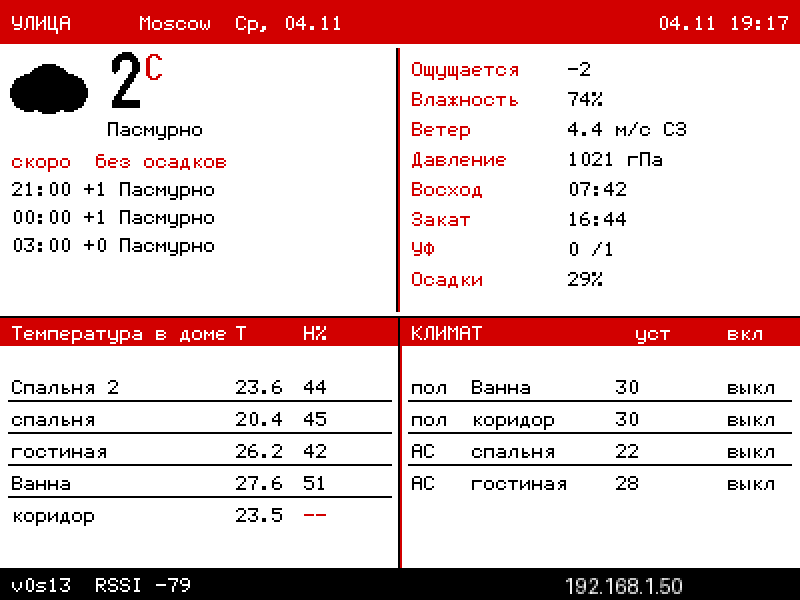
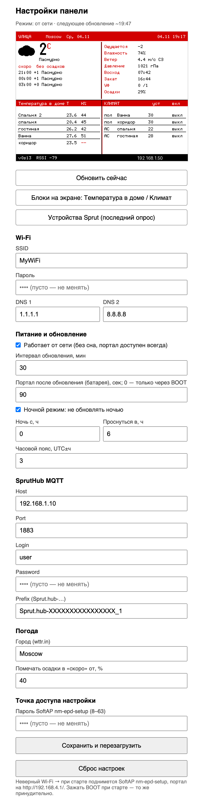
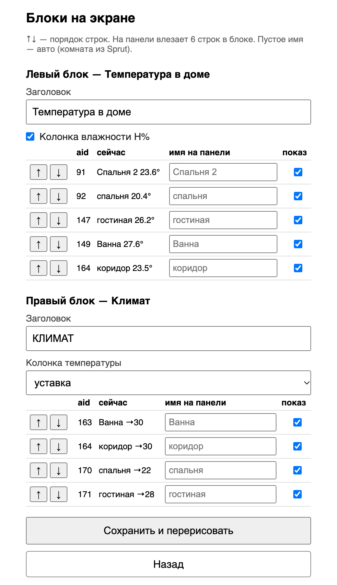
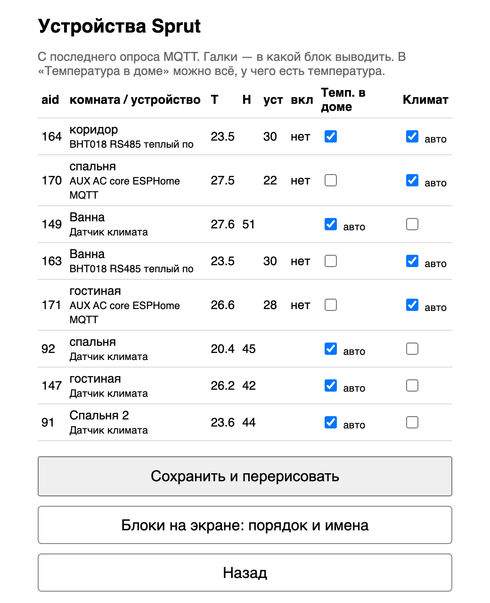

# NM-EPD-420 SprutHub e-ink dashboard — погода и SprutHub на e-ink

Прошивка для **ESP32-S3** с 3-цветной e-ink панелью **GDEY042Z98** (4.2", 400×300, чёрный/красный/белый).
На экране погода с [wttr.in](https://wttr.in), прогноз на ближайшие часы, температура и влажность по комнатам и состояние климатических устройств из **SprutHub** (MQTT).
Все настройки задаются в веб-портале и хранятся в NVS, перепрошивать ничего не нужно.




## Возможности

- **Улица.** Текущая погода с иконкой, «ощущается», влажность, ветер, давление, восход и закат, UV, вероятность осадков.
- **«Скоро».** Три ближайших 3-часовых слота с переходом на завтра. Осадки помечаются от порога, по умолчанию 40 %.
- **«Температура в доме».** T и H% по комнатам из SprutHub. В блок можно добавить любое устройство с температурой, например тёплый пол.
- **«Климат».** Кондиционеры и тёплые полы: уставка или текущая T, включено или выключено.
- **Редактор блоков.** Заголовки, порядок строк, свои имена, скрытие, колонка H%, «уставка/текущая».
- **Два режима питания.**
  - *Батарея*: обновление, короткое окно портала, затем deep sleep.
  - *От сети*: без сна, портал доступен всегда, перезапуск по интервалу.
- **Ночной режим.** Ночью не обновляется и просыпается в заданный час, по умолчанию с 0:00 до 6:00.
- **SoftAP `nm-epd-setup`.** Включается, если Wi-Fi не подключился или при старте зажата BOOT.

## Железо

| Сигнал | GPIO |
|---|---|
| SCK | 2 |
| MOSI | 1 |
| CS | 46 |
| DC | 4 |
| RST | 5 |
| BUSY | 6 |
| BOOT (кнопка) | 0 |

Плата: ESP32-S3, 16 MB flash, OPI PSRAM (`esp32-s3-devkitc-1`, `qio_opi`). Прошивка по USB CDC.

## Сборка и прошивка

Нужен [PlatformIO](https://platformio.org/) (`pip3 install platformio` или `brew install platformio`).

```bash
cd epd_stripes
cp src/secrets.example.h src/secrets.h   # необязательно, см. ниже
pio run -e nm-epd-420 -t upload
pio device monitor -b 115200
```

На macOS можно просто дважды кликнуть `epd_stripes/FLASH.command`. Скрипт дождётся USB-порта и прошьёт плату. Если порт не появляется, нажми RESET.

### `secrets.h`

В `src/secrets.h` лежат **дефолты** для первого запуска: Wi-Fi, MQTT, подпись в футере. Файл в `.gitignore`.

- При первом старте с пустой NVS значения копируются в NVS, дальше всё правится в портале.
- Без `secrets.h` прошивка собирается с пустыми значениями из `secrets.example.h` и сразу поднимает SoftAP для настройки.

## Первая настройка

1. Подключись к Wi-Fi `nm-epd-setup`, пароль по умолчанию `setup1234`.
2. Открой `http://192.168.4.1/`, впиши SSID и пароль, MQTT и город, нажми «Сохранить и перезагрузить».
3. После подключения IP панели появится в футере экрана. Портал дальше доступен по `http://<IP>/`.

В режиме «батарея» портал открыт `N` секунд после каждого обновления, по умолчанию 90. Если поставить 0, портал включается только кнопкой BOOT при старте.

## Веб-портал

| Главная | Блоки на экране | Устройства Sprut |
|---|---|---|
|  |  |  |

Маршруты:

| Путь | Что делает |
|---|---|
| `/` | все настройки и превью экрана |
| `/layout` | заголовки, порядок (↑↓), имена и видимость строк в обоих блоках |
| `/mqtt` | устройства из последнего опроса и назначение по блокам («авто» — по типу) |
| `/screen.bmp` | текущий кадр панели, 24-bit BMP 400×300 |
| `/refresh` | перерисовать сейчас (перезапуск) |
| `/reset` (POST) | сброс NVS к дефолтам из `secrets.h` |

В блок влезает 6 строк.

## Источники данных

- **Погода.** `wttr.in/<город>?format=j1&lang=ru`: сначала по http, при ошибке по https. Если JSON не разобрался, используется короткий текстовый формат wttr без блока «скоро».
- **SprutHub.** Панель подписывается на `<prefix>/#` (prefix вида `Sprut.hub-XXXXXXXX_1`) и 8 секунд собирает retained-значения. Затем классифицирует аксессуары по сервисам: датчики T/H идут в «Температуру в доме», термостаты и кондиционеры — в «Климат». Имена берутся из комнаты в SprutHub.
- **Время.** NTP, часовой пояс задаётся в портале (UTC±ч).

## Структура

```
epd_stripes/
  platformio.ini          env nm-epd-420, зависимости из PlatformIO Registry
  src/main.cpp            вся прошивка
  src/secrets.example.h   шаблон дефолтов
  FLASH.command           прошивка двойным кликом (macOS)
docs/                     скриншоты
```

Библиотеки: GxEPD2, Adafruit GFX, U8g2_for_Adafruit_GFX (кириллица), ArduinoJson 7, PubSubClient.
